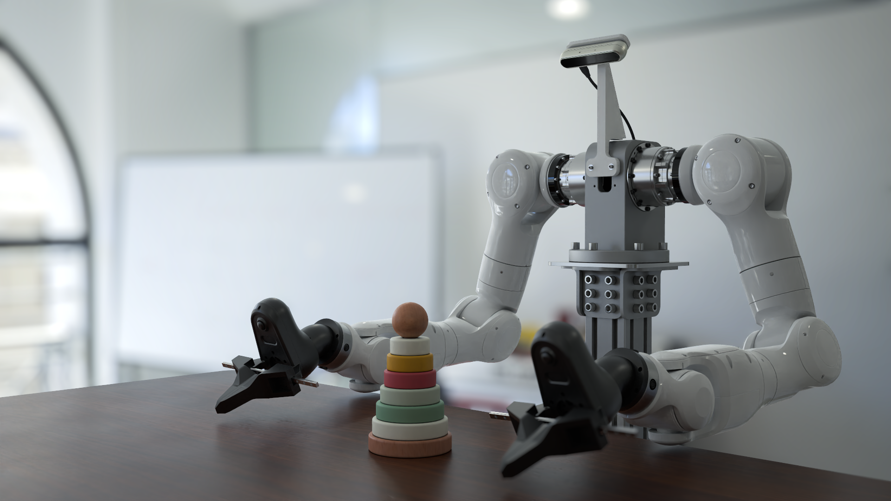

# Introduction

**Genesis World** is a simulation platform for physical AI development. It combines a unified multi-physics engine, a photorealistic renderer ([Nyx](https://github.com/Genesis-Embodied-AI/genesis-nyx)), and a cross-platform compiler ([Quadrants](https://github.com/Genesis-Embodied-AI/quadrants)) behind a single Pythonic API. It scales from a laptop CPU to datacenter GPUs while staying readable and easy to embed in research code.

Genesis World began as an academic project in December 2024, under the name **Genesis**, and is now developed with support from [Genesis AI](https://www.genesis.ai/). For the design rationale, see the [blog post](https://www.genesis.ai/blog/the-role-of-simulation-in-scalable-robotics-genesis-world-10-and-the-path-forward).

## Stack

Genesis World is built in four layers. Above it is what you build: robotics environments, ML pipelines, or agentic simulation. Below it is your compute backend.

- **Simulation interface:** the API you use to load assets (URDF, MJCF, OBJ, GLB, USD), access entities, and set up controllers, sensors, and parallel and heterogeneous environments. It also includes a built-in viewer.
- **Physics:** a unified multi-physics engine. The rigid-body, finite element method (FEM), material point method (MPM), and particle solvers share one scene and one state. The particle solvers are position-based dynamics (PBD) and smoothed particle hydrodynamics (SPH). Explicit, SAP, and [libuipc](https://github.com/spiriMirror/libuipc)-based couplers resolve contact between them.
- **Render:** Four rendering paths sit behind the cameras:
  - [Nyx](https://github.com/Genesis-Embodied-AI/genesis-nyx) is an in-house renderer built for robotics. It is installed as the `gs-nyx` plugin.

  - Luisa is a domain-specific language (DSL) ray tracer.

  - Pyrender is a rasterizer.

  - The Madrona-based batch renderer renders many environments at once.
- **Compiler:** [Quadrants](https://github.com/Genesis-Embodied-AI/quadrants) complies Python kernel code to CUDA, AMD ROCm, Apple Metal, Vulkan, x86, and ARM64. It carries the autodiff, GPU-graph, and fast-cache machinery.

## Philosophy

Genesis World is built on a few design principles for physical AI simulation.

- **Transparent and Pythonic:** the engine is open source and written in Python, so you can read it, debug it, and extend it. No opaque binary sits between you and the physics.
- **One scene, one state:** rigid, FEM, MPM, and particle (PBD/SPH) solvers share a single scene and a single state, and where their entities touch, an explicit coupler resolves the interaction.
- **Fast at full accuracy:** Genesis World parallelizes simulation across environments on the GPU. It is measured at up to 10 to 80 times the throughput of prior GPU-accelerated simulators such as Isaac Gym, Isaac Sim, Isaac Lab, and MuJoCo MJX, with no loss of accuracy. See the [blog post](https://www.genesis.ai/blog/the-role-of-simulation-in-scalable-robotics-genesis-world-10-and-the-path-forward) for methodology.
- **Differentiable by design:** autodiff and backpropagation run through the [Quadrants](https://github.com/Genesis-Embodied-AI/quadrants) compiler. Hand-derived gradients cover the hardest kernels, so gradients flow through the physics.
- **Perception built in:** physically accurate, differentiable tactile sensors sit alongside IMU, lidar, depth-camera, contact-force, surface-distance, and temperature-grid sensors. All three renderers share one camera-sensor interface. All of these work in parallel and heterogeneous environments without extra setup.
- **Easy to start, easy to scale:** install with a single `pip install`. The API is small. The same code runs one environment on a laptop or thousands on a datacenter GPU.

## Mission

Simulation trains policies, generates data, and turns computation into capability. Researchers have long been stalled because the existing simulators are hard to learn or the simulators are inaccessible. These simulators have intricate data-centric abstractions, heavy APIs, and physics that researchers cannot inspect or adapt to what they observe in the real world.

Genesis World exists to change that. Our code is open, and so is our platform. We are a platform where researchers from physics simulation and robotics build a fast, physically and visually realistic virtual world together, and where the computer-graphics community's advances in simulation and rendering reach robotics instead of staying out of reach.

Genesis World is developed in the open. To report a problem or propose a change, open an issue or a pull request on [GitHub](https://github.com/Genesis-Embodied-AI/genesis-world).
